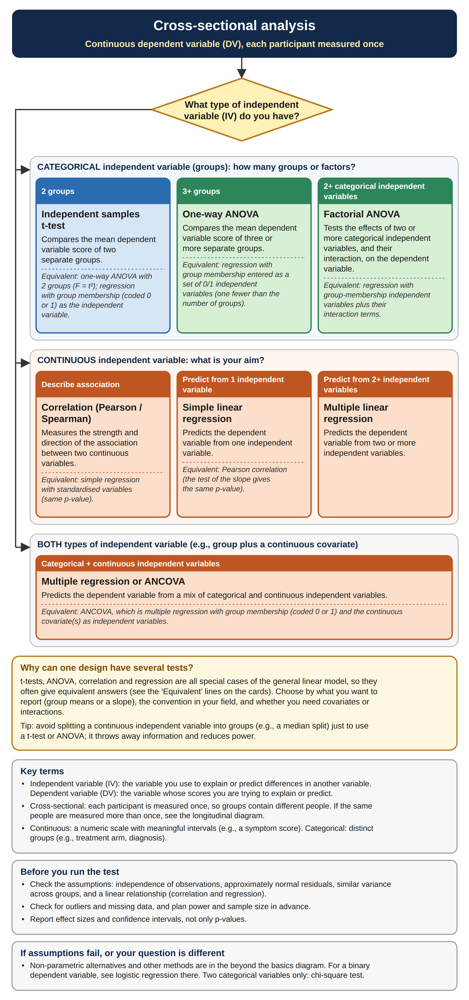
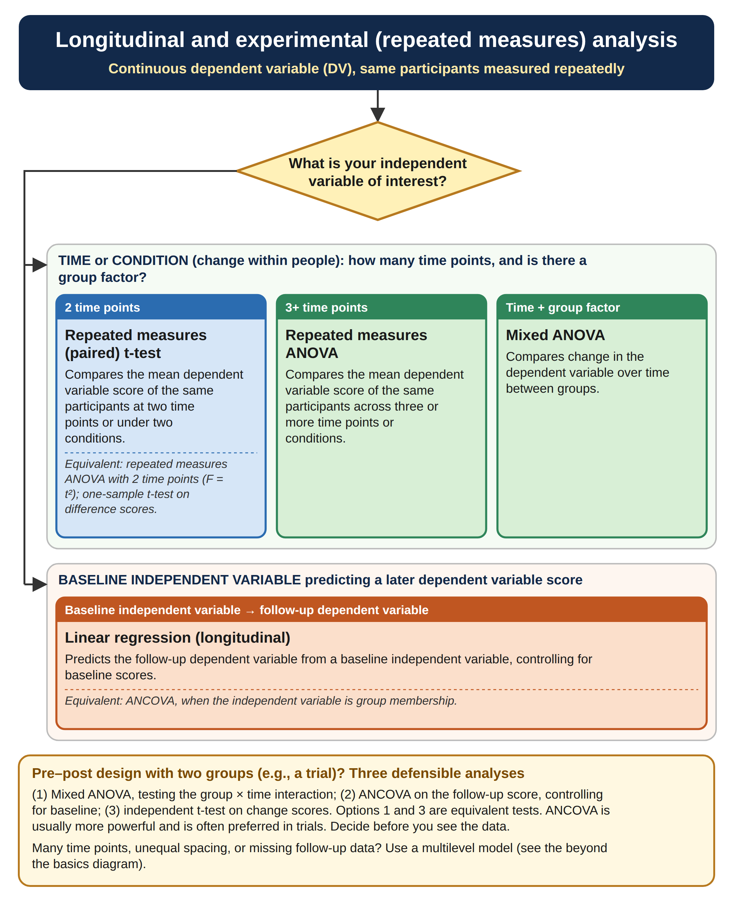
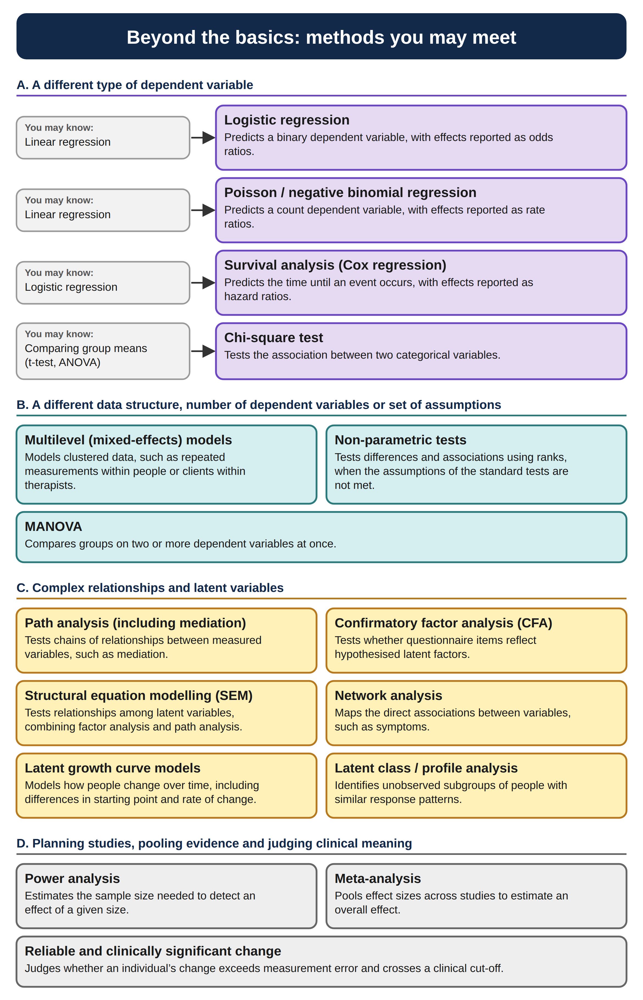

# Choosing a statistical test

Let's review which statistical test matches which design. Have a read of each diagram explaining which statistical test matches what kind of research design and then have a go at the quiz.

## Cross-sectional

```{=html}
<style>
  .sq-section { margin: 1.5em 0 0.5em; }
  .sq-section h3 { margin-bottom: 0.2em; }
  .sq-section p.sq-sub { margin-top: 0; color: #555; font-size: 0.95em; }
  .sq-card { border: 1px solid #ddd; padding: 15px; border-radius: 8px; max-width: 640px; margin: 12px 0; }
  .sq-card select { max-width: 100%; margin-right: 8px; padding: 4px; }
  .sq-card button { padding: 4px 12px; cursor: pointer; }
  .sq-fb { margin: 10px 0 0; min-height: 1.2em; }
  .sq-ok  { color: #1e7a3c; }
  .sq-bad { color: #b3261e; }
</style>
<script>
/* Renders one quiz section into the element with id `rootId`.
   Question numbers continue across sections. Answer order is shuffled on each page load. */
function sqRender(rootId, sec) {
  function shuffle(arr) {
    for (var i = arr.length - 1; i > 0; i--) {
      var j = Math.floor(Math.random() * (i + 1)), t = arr[i]; arr[i] = arr[j]; arr[j] = t;
    }
    return arr;
  }
  var root = document.getElementById(rootId);
  if (!root) { return; }
  root.innerHTML = "";
  var n = document.querySelectorAll(".sq-card").length;
  var head = document.createElement("div");
  head.className = "sq-section";
  head.innerHTML = "<h3></h3><p class='sq-sub'></p>";
  head.querySelector("h3").textContent = sec.title;
  head.querySelector(".sq-sub").textContent = sec.sub;
  root.appendChild(head);
  sec.questions.forEach(function (item) {
    n++;
    var id = "sq" + n;
    var opts = shuffle(item.options.map(function (text, i) { return { text: text, ok: i === item.correct }; }));
    var card = document.createElement("div");
    card.className = "sq-card";
    var html = "<p><strong>Question " + n + "</strong></p><p>" + item.q + "</p>" +
               "<select id='" + id + "' aria-label='Answer for question " + n + "'><option value=''>-- Select an answer --</option>";
    opts.forEach(function (o) { html += "<option value='" + (o.ok ? "correct" : "wrong") + "'>" + o.text + "</option>"; });
    html += "</select><button type='button'>Check answer</button><p class='sq-fb' role='status' aria-live='polite'></p>";
    card.innerHTML = html;
    var sel = card.querySelector("select"), fb = card.querySelector(".sq-fb");
    card.querySelector("button").addEventListener("click", function () {
      fb.className = "sq-fb";
      if (sel.value === "correct") { fb.classList.add("sq-ok"); fb.textContent = "\u2714 Correct! " + item.right; }
      else if (sel.value === "wrong") { fb.classList.add("sq-bad"); fb.textContent = "\u2718 Not quite. " + item.hint; }
      else { fb.textContent = "Please select an answer."; }
    });
    root.appendChild(card);
  });
}
</script>
```

```{r flow-cross-sectional, echo=FALSE, fig.cap="Flow diagram for cross-sectional tests"}

```

```{=html}
<div id="sq-cross"></div>
<script>
sqRender("sq-cross", {
  title: "Cross-sectional analysis",
  sub: "Continuous dependent variable (DV), each participant measured once.",
  questions: [
    { q: "A researcher wants to know whether two <strong>separate groups</strong> differ in their mean anxiety scores. Which statistical test is most appropriate?",
      options: ["Independent samples t-test", "Repeated measures (paired) t-test", "Chi-square test", "Correlation (Pearson / Spearman)"], correct: 0,
      right: "The independent samples t-test compares the mean dependent variable score of two separate groups.",
      hint: "Think about how many groups there are and whether different people are in each group." },

    { q: "A psychologist wants to compare depression scores across <strong>three different therapy groups</strong> (each participant is in one group only). Which statistical test is most appropriate?",
      options: ["Independent samples t-test", "One-way ANOVA", "Factorial ANOVA", "Correlation (Pearson / Spearman)"], correct: 1,
      right: "One-way ANOVA compares the mean dependent variable score of three or more separate groups.",
      hint: "Count the groups, and count how many categorical independent variables there are." },

    { q: "A psychologist compares depression scores across <strong>three therapy types and two genders</strong>, and wants to know whether the effect of therapy differs by gender. Which statistical test is most appropriate?",
      options: ["One-way ANOVA", "Factorial ANOVA", "Independent samples t-test", "Correlation (Pearson / Spearman)"], correct: 1,
      right: "Factorial ANOVA tests the effects of two or more categorical independent variables, and their interaction, on the dependent variable.",
      hint: "How many categorical independent variables are there?" },

    { q: "A researcher wants to <strong>describe the association</strong> between hours of sleep and exam scores (both continuous), without treating either variable as the independent variable. Which statistical test is most appropriate?",
      options: ["Independent samples t-test", "Chi-square test", "Correlation (Pearson / Spearman)", "One-way ANOVA"], correct: 2,
      right: "Correlation measures the strength and direction of the association between two continuous variables.",
      hint: "Both variables are continuous and the aim is to describe an association." },

    { q: "A researcher wants to <strong>predict exam scores from hours of study</strong> (one continuous independent variable). Which statistical test is most appropriate?",
      options: ["Independent samples t-test", "Simple linear regression", "Multiple linear regression", "One-way ANOVA"], correct: 1,
      right: "Simple linear regression predicts the dependent variable from one independent variable.",
      hint: "How many independent variables are being used, and are they continuous?" },

    { q: "A researcher wants to investigate whether <strong>age, weekly hours of exercise and a diet quality score</strong> predict blood pressure. Which statistical test is most appropriate?",
      options: ["One-way ANOVA", "Multiple linear regression", "Simple linear regression", "Chi-square test"], correct: 1,
      right: "Multiple linear regression predicts the dependent variable from two or more independent variables.",
      hint: "Think about how many independent variables there are." }
  ]
});
</script>
```

## Longitudinal

```{r flow-longitudinal, echo=FALSE, fig.cap="Flow diagram for longitudinal tests"}

```

```{=html}
<div id="sq-long"></div>
<script>
sqRender("sq-long", {
  title: "Longitudinal and experimental (repeated measures) analysis",
  sub: "Continuous dependent variable (DV), same participants measured repeatedly.",
  questions: [
    { q: "A researcher measures participants\u2019 blood pressure <strong>before and after</strong> an exercise programme (one group). Which statistical test is most appropriate?",
      options: ["Independent samples t-test", "Repeated measures (paired) t-test", "One-way ANOVA", "Correlation (Pearson / Spearman)"], correct: 1,
      right: "The same participants are measured at two time points, so the repeated measures (paired) t-test is appropriate.",
      hint: "Consider whether the two sets of scores come from the same participants." },

    { q: "A researcher measures one group\u2019s memory performance <strong>before training, immediately after training, and one month later</strong>. Which statistical test is most appropriate?",
      options: ["Repeated measures (paired) t-test", "Repeated measures ANOVA", "One-way ANOVA", "Mixed ANOVA"], correct: 1,
      right: "The same participants are measured at three time points, so repeated measures ANOVA is appropriate.",
      hint: "Count the time points, and check whether there is also a group factor." },

    { q: "A researcher compares a <strong>treatment group and a control group</strong>, measuring anxiety before the intervention, immediately after, and at a 3-month follow-up. Which statistical test is most appropriate?",
      options: ["Repeated measures ANOVA", "Mixed ANOVA", "One-way ANOVA", "Independent samples t-test"], correct: 1,
      right: "Mixed ANOVA combines a within-person factor (time) with a between-person factor (group), and asks whether change over time differs between groups.",
      hint: "The design has repeated measurements and independent groups." },

    { q: "A researcher wants to know whether <strong>baseline self-esteem</strong> (continuous) is associated with depression scores six months later, taking baseline depression scores into account. Which statistical test is most appropriate?",
      options: ["Repeated measures (paired) t-test", "Mixed ANOVA", "Linear regression (controlling for baseline)", "Independent samples t-test"], correct: 2,
      right: "Linear regression predicts the follow-up dependent variable from a baseline independent variable, controlling for baseline scores.",
      hint: "Is the independent variable time or condition, or a baseline variable predicting a later score?" },

    { q: "A trial randomly assigns participants to treatment or control and measures anxiety before and after the intervention. Which of the following is <strong>NOT</strong> a defensible way to test whether the treatment worked?",
      options: ["Mixed ANOVA (group \u00d7 time interaction)", "ANCOVA on the follow-up score, controlling for baseline", "Independent samples t-test on change scores", "Repeated measures (paired) t-test on all participants combined"], correct: 3,
      right: "A paired t-test on everyone combined ignores the group factor, so it cannot show whether change differs between treatment and control. The other three are all defensible; ANCOVA is often preferred in trials.",
      hint: "Which analysis ignores the comparison between groups?" }
  ]
});
</script>
```

## Beyond the basics

```{r flow-beyondbasics, echo=FALSE, fig.cap="Flow diagram for extra statistical tests"}

```

```{=html}
<div id="sq-beyond"></div>
<script>
sqRender("sq-beyond", {
  title: "Beyond the basics",
  sub: "Methods for other types of dependent variable, data structure or research question.",
  questions: [
    { q: "A researcher wants to determine whether <strong>smoking status (smoker / non-smoker) is associated with gender (male / female)</strong>. Which statistical test is most appropriate?",
      options: ["Independent samples t-test", "Correlation (Pearson / Spearman)", "One-way ANOVA", "Chi-square test"], correct: 3,
      right: "The chi-square test tests the association between two categorical variables.",
      hint: "Think about the type of both variables." },

    { q: "A researcher wants to know whether age, BMI and smoking status predict whether a patient develops diabetes (<strong>yes / no</strong>). Which statistical analysis is most appropriate?",
      options: ["Multiple linear regression", "Logistic regression", "Poisson / negative binomial regression", "Chi-square test"], correct: 1,
      right: "Logistic regression predicts a binary dependent variable, with effects reported as odds ratios.",
      hint: "Consider the type of the dependent variable." },

    { q: "A psychologist wants to compare three therapy groups on <strong>anxiety, depression and stress scores simultaneously</strong>. Which statistical test is most appropriate?",
      options: ["One-way ANOVA", "MANOVA", "Multiple linear regression", "Chi-square test"], correct: 1,
      right: "MANOVA compares groups on two or more dependent variables at once.",
      hint: "How many dependent variables are being analysed?" },

    { q: "Symptom scores are collected from clients who each see one of 20 therapists, so <strong>clients are clustered within therapists</strong>. Which method is designed for data like this?",
      options: ["Independent samples t-test", "One-way ANOVA", "Multilevel (mixed-effects) models", "Chi-square test"], correct: 2,
      right: "Multilevel (mixed-effects) models handle clustered data, such as repeated measurements within people or clients within therapists.",
      hint: "Are the observations independent of one another?" },

    { q: "A researcher wants to test whether the items of a new questionnaire reflect <strong>two hypothesised latent factors</strong> (depression and anxiety) that were specified in advance. Which method is most appropriate?",
      options: ["Correlation (Pearson / Spearman)", "MANOVA", "Confirmatory factor analysis (CFA)", "Path analysis (including mediation)"], correct: 2,
      right: "Confirmatory factor analysis tests whether questionnaire items reflect hypothesised latent factors.",
      hint: "Are you testing a pre-specified structure of latent variables?" },

    { q: "A researcher studies the <strong>time from the end of therapy until relapse</strong>, and some participants have not relapsed by the end of the study. Which method is most appropriate?",
      options: ["Logistic regression", "Poisson / negative binomial regression", "Survival analysis (Cox regression)", "Multiple linear regression"], correct: 2,
      right: "Survival analysis predicts the time until an event occurs, and allows for people who have not yet had the event.",
      hint: "Is the dependent variable a yes/no, a count, or the time until an event?" }
  ]
});
</script>
```
