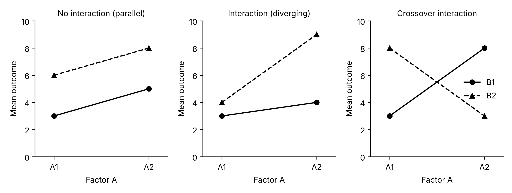

# ANOVA {#anova}

```{r anova-setup, include=FALSE}
knitr::opts_chunk$set(echo = FALSE, message = FALSE, warning = FALSE)

# Optional: the figures in this chapter are drawn from the practice dataset.
# Save 't-test_anova_practice_data.csv' in a folder called 'data' next to this file.
# If the file is not found, the figures are simply skipped.
anova_data_path <- "data/t-test_anova_practice_data.csv"
have_data <- file.exists(anova_data_path)
if (have_data) anova_dat <- read.csv(anova_data_path, stringsAsFactors = TRUE)
```

In a previous chapter you used *t*-tests to compare **two** means. But research questions are rarely that tidy. You might want to compare three or more groups, measure the same people several times, or ask whether an effect is bigger for some people than for others. The **Analysis of Variance (ANOVA)** is a family of tests that extends the *t*-test to answer these questions.

In this chapter you will work through five different types of ANOVA using one dataset, learn which research question each one answers, and practise reporting the results.

**Learning objectives**

1. Match a research question and design to the correct type of ANOVA
2. Run one-way, factorial, repeated measures and mixed ANOVAs, and ANCOVA, in JASP
3. Check the assumptions of each ANOVA and decide what to do if they are violated
4. Interpret main effects, interactions, post hoc tests and effect sizes
5. Report the results of an ANOVA in a clear, standardised way

## The dataset {#anova-dataset}

Load the dataset ‘t-test_anova_practice_data.csv’ into JASP by clicking Open -> Computer and then finding where you have saved the dataset on your computer.

This is a **fictional** study of 240 university students. Half of the students took part in an 8-week mindfulness programme (*Mindfulness*) and half did not (*Control*). Every student completed measures of depression, anxiety and stress at three time points: before the programme (T1, baseline), straight after it (T2, post-intervention), and three months later (T3, follow-up). Higher scores mean *more* distress.

**Data dictionary**

| Variable                 | Description                                                              |
| ------------------------ | ------------------------------------------------------------------------ |
| ParticipantID            | Participant ID                                                           |
| Age                      | Age in years                                                             |
| Gender                   | Man, Woman or Non-binary                                                 |
| Year_of_Study            | Year of university study (1, 2 or 3)                                     |
| Accommodation            | Living at home or Living away from home                                  |
| Exercise_Level           | Self-reported exercise level (Low, Moderate or High)                     |
| Social_Support           | Perceived social support (Low or High)                                   |
| Condition                | Mindfulness or Control                                                   |
| Sleep_Hours              | Average hours of sleep per night                                         |
| DEP_T1, DEP_T2, DEP_T3   | Depression score at baseline, post-intervention and follow-up            |
| ANX_T1, ANX_T2, ANX_T3   | Anxiety score at baseline, post-intervention and follow-up               |
| STR_T1, STR_T2, STR_T3   | Stress score at baseline, post-intervention and follow-up                |
| Total_Distress_T1/T2/T3  | Depression + Anxiety + Stress at each time point                         |

### Getting the data ready {#anova-prep}

Before running any analysis, work through the pre-analysis steps from Chapter 7.

1. Check the variable types. Variables that you want to use as a **grouping variable (a ‘factor’)** must be **nominal** or **ordinal**; variables you want to use as an **outcome** must be **scale**. 

2. *Tip*: JASP orders the levels of a text variable alphabetically, so `Exercise_Level` will appear as High, Low, Moderate rather than Low, Moderate, High. To fix this, double-click on the column name. Then under 'label editor', untick 'automatically order labels by their values'. Then click on 'Low' (be careful not to click on the tick which will then filter out all those who were low on this variable) and then click on the up or down arrow at the side to change the order so that 'moderate' is in the middle. This makes your tables and plots much easier to read.

3. Click on ‘Descriptives’ -> ‘Descriptive Statistics’ and bring every variable except `ParticipantID` over to ‘Variables’. Check the minimum and maximum of each variable and look at the frequency tables for the categorical variables (see Section 7.1). Are there any impossible values? Is there any missing data? (There shouldn't be: this dataset has been cleaned for you.)

4. Use ‘Descriptive Statistics’ again, this time splitting by `Condition`, to check how many people are in each group.

## What is an ANOVA, and why not just run lots of *t*-tests? {#anova-why}
Before you carry on: the number of people in each group matters for ANOVA. Designs where each group (or ‘cell’) has the same number of participants are called **balanced**, and designs where they don't are **unbalanced**. Some of the groups in this dataset are balanced (e.g., 120 people in each `Condition`) and some are not (e.g., there are only 22 non-binary participants). Keep an eye out for what this means as we go.

Imagine you want to compare depression across the three exercise levels. You could run three *t*-tests (Low vs Moderate, Low vs High, Moderate vs High). But every test you run carries a 5% chance of a false positive (a Type I error) if the null hypothesis is true. Across three tests the chance of getting **at least one** false positive climbs to around 14%, and it gets worse the more groups you have. ANOVA solves this by first asking **one** overall question: *are the group means different anywhere?*

It does this by comparing two kinds of variability:

- **Between-group variance**: how much the group means differ from each other (the ‘signal’)
- **Within-group variance**: how much individual people differ from each other within the same group (the ‘noise’)

The **F-ratio** is simply:

$$F = \frac{\text{variance between groups}}{\text{variance within groups}}$$

If the groups really are the same, *F* will be close to 1. The bigger *F* is, the more the group differences stand out above the noise. If you only have two groups, ANOVA gives you exactly the same answer as a *t*-test (in fact, *F* = *t*²).

**Key vocabulary**

| Term                  | Meaning                                                                                                      |
| --------------------- | ------------------------------------------------------------------------------------------------------------ |
| Factor                | A categorical variable you are using to define groups or conditions (e.g., `Condition`)                      |
| Level                 | One of the categories within a factor (e.g., ‘Mindfulness’ and ‘Control’ are the two levels of `Condition`) |
| Between-subjects      | Different people are in each level of the factor (e.g., `Condition`)                                         |
| Within-subjects       | The *same* people are measured at every level of the factor (e.g., `Time`). Also called ‘repeated measures’ |
| Main effect           | The effect of one factor on the outcome, averaging over the other factors                                    |
| Interaction           | When the effect of one factor *depends on* the level of another factor                                       |
| Covariate             | A continuous variable that you want to statistically control for                                             |
| Post hoc test         | A follow-up test that works out *which* groups differ, after a significant overall *F*-test                  |

## Which ANOVA should I use? {#anova-choosing}

Different types of ANOVA answer different kinds of questions. The key things to work out are: **how many factors do I have?**, **are they between-subjects or within-subjects?**, and **do I have a continuous variable I want to control for?** You will have seen this in the flow diagrams in Chapter 3.

| Type of ANOVA                         | Design                                                                            | Question it answers                                                   | Example from this dataset                                                                      |
| ------------------------------------- | --------------------------------------------------------------------------------- | --------------------------------------------------------------------- | ---------------------------------------------------------------------------------------------- |
| **One-way ANOVA**                     | 1 between-subjects factor with 3 or more levels                                   | Do three or more independent groups differ on the outcome?            | Does baseline depression differ between low, moderate and high exercisers?                     |
| **Factorial (two-way) ANOVA**         | 2 or more between-subjects factors                                                | Does each factor affect the outcome? Does one factor *change* the effect of the other? | Does the effect of mindfulness on stress depend on how much social support someone has?  |
| **Repeated measures ANOVA**           | 1 within-subjects factor with 3 or more levels                                    | Does the outcome change across three or more time points or conditions in the same people? | Did distress change from T1 to T2 to T3 in students who did mindfulness?             |
| **Mixed ANOVA**                       | At least 1 between-subjects factor *and* at least 1 within-subjects factor        | Does the *change over time* differ between groups?                    | Did distress change differently over time in the mindfulness and control groups?               |
| **ANCOVA**                            | 1 or more between-subjects factors plus 1 or more continuous covariates           | Do groups differ on the outcome *after controlling for* a covariate?  | Do the mindfulness and control groups differ at T3 after controlling for baseline distress?   |

Two important notes:

- If you only have **two** groups or **two** time points, you don't need an ANOVA; a t-test (independent or paired) will do.
- ANOVA tells you whether there is a difference, not *what the difference looks like*. You always need to look at your descriptive statistics and plots as well.

## Effect sizes for ANOVA {#anova-effect-sizes}

Chapter 6 explained why a *p* value is not enough and why we also need effect sizes (see Section 6.3.1). For ANOVA, JASP offers four effect sizes, which come in two pairs:

| Effect size           | Symbol | What it tells you                                                                                                       | When to use it                                                                 |
| --------------------- | ------ | ----------------------------------------------------------------------------------------------------------------------- | ------------------------------------------------------------------------------ |
| Eta squared           | η²     | Proportion of the *total* variance in your sample's outcome that is explained by the factor                             | One-way ANOVA (easy to understand, but it overestimates the population effect) |
| Partial eta squared   | η~p~²  | Proportion of variance explained by the factor *after removing variance explained by the other factors in the model*    | Factorial, repeated measures, mixed and ANCOVA designs                         |
| Omega squared         | ω²     | Like η², but corrected for bias, so a better estimate of the effect in the *population*                                 | One-way designs and small samples                                              |
| Partial omega squared | ω~p~²  | Like η~p~², but corrected for bias, so a better estimate of the population effect once other factors are removed         | Factorial, repeated measures, mixed and ANCOVA designs, especially small samples |

In short: the **eta** versions describe the effect in your *sample* and tend to be slightly too large, whereas the **omega** versions correct for this to estimate the effect in the *population*; and the **partial** versions only compare the effect to the leftover (error) variance, ignoring variance explained by other factors, whereas the non-partial versions compare it to the *total* variance.

**Rule of thumb.** For all four, the usual guidelines (based on Cohen, 1988, who proposed them for η²) are **.01 = small, .06 = medium, .14 = large**. As always, these are rough guides: a ‘small’ effect can still be clinically important (see Section 6.3). Because omega is bias-corrected, ω² will usually be a little smaller than η² for the same data, and partial values will be larger than non-partial values in designs with several factors, so effect sizes are not directly comparable across studies with different designs. Always say which one you are reporting.

For *post hoc* comparisons between two groups, JASP gives you Cohen's *d* (.2 = small, .5 = medium, .8 = large).

## One-way ANOVA {#anova-oneway}

**The question**: Does baseline depression (`DEP_T1`) differ between students with low, moderate and high levels of exercise?

We use the baseline (T1) measurement here because it was taken before the mindfulness programme started, so `Condition` shouldn't have had any effect yet.

- **Outcome (dependent variable)**: `DEP_T1` (scale)
- **Factor (independent variable)**: `Exercise_Level` (3 levels: Low, Moderate, High)
- **Null hypothesis**: the mean depression score is the same in all three exercise groups
- **Alternative hypothesis**: at least one group has a different mean depression score

### Running a one-way ANOVA in JASP {#anova-oneway-jasp}

1. Click ‘ANOVA’ -> ‘Classical’ -> ‘ANOVA’. Bring `DEP_T1` into ‘Dependent Variable’ and `Exercise_Level` into ‘Fixed Factors’. Click on the **bold title** and rename the analysis something more specific, for example **A One-Way ANOVA of Baseline Depression by Exercise Level**.

2. Under ‘Display’, tick ‘Descriptive statistics’. Under ‘Estimates of effect size’ tick η² and ω².

3. Open ‘Assumption Checks’ and tick ‘Homogeneity tests’ and ‘Q-Q plot of residuals’.

4. Open ‘Descriptive Plots’. Bring `Exercise_Level` into ‘Horizontal axis’ and tick ‘Display error bars’ (95% confidence interval).

5. Open ‘Post Hoc Tests’. Bring `Exercise_Level` into the box on the right. Tick ‘Effect size’ and ‘Confidence intervals’ and make sure ‘Tukey’ is ticked under ‘Correction’.

*Tip*: The wording of some menus changes a little between versions of JASP. If you can't find an option, click on the blue ‘i’ button for the help file.

### Reading the output {#anova-oneway-output}

**ANOVA table.** You should see something like this:

| Cases          | Sum of Squares | df  | Mean Square | *F*   | *p*     | η²   | ω²   |
| -------------- | -------------- | --- | ----------- | ----- | ------- | ---- | ---- |
| Exercise_Level | 1554        | 2   | 776.9      | 20.76 | < .001  | .1491 | .1414 |
| Residuals      | 886        | 237 | 37.41       |       |         |      |      |

- **df**: the degrees of freedom. The first is for the factor (number of groups − 1 = 2). The second is for the residuals (total sample size − number of groups = 240 − 3 = 237). You need both when you report *F*.
- **Mean Square**: Sum of Squares divided by df. The *F* value is the factor's Mean Square divided by the Residual Mean Square (776.87 / 37.41 = 20.76).
- **η² and ω²**: about 14–15% of the variance in baseline depression is explained by exercise level. By the rules of thumb above, this is a *large* effect.

**Descriptive statistics.**

| Exercise_Level | *N* | Mean  | SD   |
| -------------- | --- | ----- | ---- |
| Low            | 80  | 14.65 | 6.912 |
| Moderate       | 80  | 10.70 | 5.764 |
| High           | 80  | 8.50  | 5.589 |

Remember: the ANOVA only tells us that *at least one* group differs. The descriptives and plot suggest depression goes down as exercise goes up, but we need the post hoc tests to find out which groups actually differ from each other.

### Checking the assumptions {#anova-oneway-assumptions}

A one-way ANOVA has four assumptions. As in the *t*-test chapter, think about which are about **study design** and which are about **statistical analysis**.

| Assumption                            | Type      | How to check                                                                                 |
| ------------------------------------- | --------- | -------------------------------------------------------------------------------------------- |
| Continuous outcome                    | Design    | Is the outcome measured on a scale with meaningful distances?                                |
| Independence of observations          | Design    | Is each person in one group only, and did participants not influence each other's scores?    |
| Normally distributed **residuals**    | Analysis  | Q-Q plot of residuals; skewness and kurtosis; Shapiro-Wilk                                   |
| Homogeneity of variance               | Analysis  | Levene's test (or Brown-Forsythe); compare the group standard deviations                     |

**Normality.** Remember from Section 7.3 that for ANOVA the normality assumption concerns the *residuals*, not the raw variable. Look at the Q-Q plot of residuals: if the points follow the diagonal line reasonably well, you are fine. 

**Homogeneity of variance.** Levene's test gives *F*(2, 237) = 2.76, *p* = .066. This is not significant at the .05 level, but it is close, so it is sensible to check the 

**If assumptions are violated**: use Welch's ANOVA (and the Games-Howell post hoc test) if variances are unequal, especially if group sizes are unequal. Use Kruskal-Wallis (with Dunn's post hoc test) or bootstrapping if normality is badly violated and the sample is small. Always report what you did and whether the conclusions changed.

### Post hoc tests {#anova-posthoc}

When a one-way ANOVA is significant and there are three or more groups, you follow up with **post hoc tests** to see which pairs of groups differ. These compare every pair of groups, but adjust the *p* values so that you don't inflate the false-positive rate.

| Post hoc test | Use when                                                                                           |
| ------------- | -------------------------------------------------------------------------------------------------- |
| Tukey         | The standard choice for all pairwise comparisons when variances are roughly equal                  |
| Scheffé       | Very conservative; used for complex comparisons                                                    |
| Bonferroni    | Simple and conservative; multiplies each *p* by the number of tests                                |
| Holm          | Like Bonferroni, but always at least as powerful. A good general-purpose alternative               |


Your Tukey table should look like this:

| Comparison          | Mean difference | 95% CI          | Cohen's *d* | *p*~tukey~ |
| ------------------- | --------------- | --------------- | ----------- | ---------- |
| Low − Moderate      | 3.95            | [1.67, 6.23]    | 0.65        | < .001     |
| Low − High          | 6.15            | [3.87, 8.43]    | 1.01        | < .001     |
| Moderate − High     | 2.20            | [−0.08, 4.48]   | 0.36        | .061       |

Students with low exercise levels had significantly higher baseline depression than both other groups. The difference between moderate and high exercisers is small and, using Tukey's correction, does not reach significance at the .05 level.

**A word of warning about ‘shopping around’.** Look what happens to the Moderate − High comparison under different corrections:

| Correction     | Approximate *p* for Moderate − High |
| -------------- | ----------------------------------- |
| Tukey          | .061                                |
| Bonferroni     | .07                                 |
| Holm           | .024                                |

A result that is ‘non-significant’ under one correction can be ‘significant’ under another. The right thing to do is to **decide on your post hoc test before you look at the results** (ideally in your pre-registration, see Chapter 5), justify it from your design (e.g., equal group sizes and roughly equal variances point to Tukey), and report it. Picking the correction that gives you the answer you want is a form of *p*-hacking. Where a result is borderline, as it is here, it is more honest to say so and to focus on the size and confidence interval of the difference rather than on the *p* value alone.

### Reporting a one-way ANOVA {#anova-oneway-report}

**Reporting a one-way ANOVA**

A one-way between-subjects ANOVA was used to compare [outcome] across [groups]. [Outcome] *differed significantly/did not differ significantly* between groups, *F*(*df*~between~, *df*~within~) = *F*, *p* = *p*, ω² = ω². [Post hoc test] post hoc comparisons showed that [Group 1] (*M* = ?, *SD* = ?) [differed from/did not differ from] [Group 2] (*M* = ?, *SD* = ?), mean difference = ?, 95% CI [?, ?], *p* = *p*, *d* = *d*.

**Completed example**

A one-way between-subjects ANOVA indicated that baseline depression differed significantly between students with low (*M* = 14.65, *SD* = 6.91), moderate (*M* = 10.70, *SD* = 5.76) and high (*M* = 8.50, *SD* = 5.59) levels of exercise, *F*(2, 237) = 20.76, *p* < .001, ω² = .14. Levene's test indicated that the assumption of equal variances was met, *F*(2, 237) = 2.76, *p* = .066, and a Welch ANOVA gave the same conclusion, *F*(2, 156.80) = 19.11, *p* < .001. Tukey post hoc comparisons showed that students with low exercise levels reported significantly higher depression than those with moderate exercise (mean difference = 3.95, 95% CI [1.67, 6.23], *p* < .001, *d* = 0.65) and those with high exercise (mean difference = 6.15, 95% CI [3.87, 8.43], *p* < .001, *d* = 1.01). Moderate and high exercisers did not differ significantly (mean difference = 2.20, 95% CI [−0.08, 4.48], *p* = .061, *d* = 0.36).

*Note*: report *F* and *d* to two decimal places and *p* to three decimal places, as in the *t*-test chapter. Where *p* is smaller than .001, write *p* < .001.

### Exercise {#anova-oneway-exercise}

Now it's your turn. Run a one-way ANOVA to determine whether baseline **anxiety** (`ANX_T1`) differs between men, women and non-binary students (`Gender`).

1. Run the ANOVA with the same options as above. Add η² and ω². Report the result in a note underneath the table.
2. This design is unbalanced (100 men, 118 women and 22 non-binary participants). Run the assumption checks. Why might unequal group sizes make you more careful about the homogeneity of variance assumption?
3. Run post hoc tests twice: once with Tukey and once with Games-Howell. Do the conclusions differ?
4. Run the Welch and Kruskal-Wallis versions as a sensitivity analysis. Does your conclusion change?
5. Write up the results using the template above.

<details>
<summary>Click to see what you should find</summary>

- Group means (SD): Man 6.90 (5.86), Woman 10.51 (6.50), Non-binary 12.73 (6.78).
- *F*(2, 237) = 12.78, *p* < .001, η² = .10, ω² = .09. This is a medium-to-large effect.
- Levene's test was not significant (*p* ≈ .54), although the Man group is somewhat positively skewed (skewness ≈ 0.81).
- Post hoc (Tukey): Men reported significantly lower anxiety than women (mean difference = −3.61, *p* < .001, *d* = −0.58) and non-binary participants (mean difference = −5.83, *p* < .001, *d* = −0.93). Women and non-binary participants did not differ significantly (mean difference = −2.22, *p* = .281, *d* = −0.35). Games-Howell gives the same pattern (the Man vs Non-binary *p* rises to about .002, but is still significant).
- Welch: *F*(2, 58.07) = 12.77, *p* < .001. Kruskal-Wallis: *H*(2) = 24.18, *p* < .001. Same conclusions.
- The non-binary group is small (*n* = 22), so the Non-binary comparisons are less precise (note the wide confidence intervals) and a non-significant difference between women and non-binary students should not be read as ‘no difference’.

</details>

## Factorial (two-way) ANOVA {#anova-factorial}

A one-way ANOVA has one factor. A **factorial ANOVA** has two or more factors, which are all crossed with each other (every level of one factor appears with every level of the other). A factorial ANOVA answers **three** questions at once:

1. Is there a **main effect** of Factor A? (Averaging over Factor B, do the levels of A differ?)
2. Is there a **main effect** of Factor B? (Averaging over Factor A, do the levels of B differ?)
3. Is there an **interaction** between A and B? (Does the effect of A *depend on* the level of B?)

**The question**: Does the effect of mindfulness on stress at follow-up (`STR_T3`) depend on how much social support a student has?

- **Outcome**: `STR_T3` (scale)
- **Factor A**: `Condition` (Mindfulness, Control)
- **Factor B**: `Social_Support` (High, Low)
- This is a **2 × 2 between-subjects design** (two factors, each with two levels). There are four groups, each with 60 participants, so the design is balanced.

### Understanding interactions {#anova-interactions}

The interaction is usually the most interesting part of a factorial ANOVA, and the easiest way to understand it is to look at a plot of the means. Lines that are **parallel** mean no interaction. Lines that are **not parallel** (they converge, diverge or cross) indicate an interaction.

```{r fixed anova interactions, echo=FALSE, fig.cap="Mean total distress at baseline"}

```

If there is a significant interaction, **be careful about interpreting the main effects on their own**, because the main effect is an average that may hide the fact that the effect is very different at different levels of the other factor. Instead, follow up the interaction with **simple main effects** (see below).

### Running a factorial ANOVA in JASP {#anova-factorial-jasp}

1. Click ‘ANOVA’ -> ‘Classical’ -> ‘ANOVA’. Bring `STR_T3` into ‘Dependent Variable’, and both `Condition` and `Social_Support` into ‘Fixed Factors’. Rename the analysis, for example **A 2 × 2 ANOVA of Follow-up Stress by Condition and Social Support**.

2. Click on ‘Model’. You will see that JASP includes both main effects *and* the interaction (`Condition * Social_Support`) by default. Leave it like this. Notice the ‘Sum of squares’ is set to ‘Type III’; this is the default and the one to use in most psychology research (it only really matters when the design is unbalanced, which we'll come back to).

3. Under ‘Display’, tick ‘Descriptive statistics’ and under ‘Estimates of effect size’ tick partial η² and ω².

4. Under ‘Assumption Checks’ tick ‘Homogeneity tests’ and ‘Q-Q plot of residuals’.

5. Under ‘Descriptive Plots’, bring `Social_Support` into ‘Horizontal axis’ and `Condition` into ‘Separate lines’. Tick ‘Display error bars’.

6. Under ‘Simple Main Effects’, set ‘Simple effect factor’ to `Condition` and bring `Social_Support` into ‘Moderator factor 1’. This asks: *what is the effect of Condition at each level of Social_Support?*

*Tip*: You do not need post hoc tests here as each factor has only two levels. If one of your factors had three or more levels, you would add post hoc tests for that factor, just like in the one-way ANOVA.

### Reading the output {#anova-factorial-output}

**Descriptive statistics** (stress at T3):

| Condition   | Social_Support | *N* | Mean  | SD   |
| ----------- | -------------- | --- | ----- | ---- |
| Control     | High           | 60  | 11.77 | 5.09 |
| Control     | Low            | 60  | 13.27 | 5.97 |
| Mindfulness | High           | 60  | 6.67  | 5.18 |
| Mindfulness | Low            | 60  | 11.93 | 5.96 |

```{r fig-factorial-plot, eval=have_data, fig.height=4, fig.width=5.5, fig.cap="Mean stress at follow-up (T3) by condition and social support. This is similar to the descriptives plot JASP produces."}
m <- tapply(anova_dat$STR_T3, list(anova_dat$Social_Support, anova_dat$Condition), mean)
cols <- c("grey40", "steelblue")
matplot(1:2, m, type = "b", pch = c(16, 17), lty = 1, col = cols,
        xaxt = "n", xlim = c(0.8, 2.2), ylim = c(4, 15),
        xlab = "Social support", ylab = "Mean stress (STR) at T3")
axis(1, at = 1:2, labels = rownames(m))
legend("topleft", legend = colnames(m), pch = c(16, 17), col = cols, lty = 1, bty = "n")
```

The lines are clearly **not parallel**. For students with high social support, mindfulness is associated with much lower stress than the control condition (6.67 vs 11.77). For students with low social support, the difference is much smaller (11.93 vs 13.27). That is what an interaction looks like.

**ANOVA table.** You should find:

| Cases                      | Sum of Squares | df  | Mean Square | *F*   | *p*     | η~p~² | ω²   |
| -------------------------- | -------------- | --- | ----------- | ----- | ------- | ----- | ---- |
| Condition                  | 620.82         | 1   | 620.82      | 20.04 | < .001  | .078  | .067 |
| Social_Support             | 686.82         | 1   | 686.82      | 22.17 | < .001  | .086  | .074 |
| Condition ✻ Social_Support | 212.82         | 1   | 212.82      | 6.87  | .009    | .028  | .021 |
| Residuals                  | 7309.53        | 236 | 30.97       |       |         |       |      |

- There is a significant **main effect of Condition**: averaged over social support, mindfulness students had lower stress than controls.
- There is a significant **main effect of Social_Support**: averaged over condition, students with high social support had lower stress.
- There is a significant **interaction**: the effect of mindfulness depends on the level of social support. Because the interaction is significant, we must not stop at the main effects. 

**Simple main effects.** This is the follow-up to a significant interaction. It tests the effect of one factor separately at each level of the other:

| Level of Social_Support | Mean difference (Mindfulness − Control) | *F*(1, 236) | *p*     |
| ----------------------- | --------------------------------------- | ----------- | ------- |
| High                    | −5.10                                   | 25.19       | < .001  |
| Low                     | −1.33                                   | 1.72        | .191    |

So mindfulness significantly reduced stress for students with **high** social support, but there was no significant effect for students with **low** social support. Note that JASP uses the residual error term from the whole model for these tests, which is why they have the same denominator degrees of freedom (236) as the main ANOVA.

*Tip*: You could just as easily have asked the question the other way round (the effect of social support within each condition). Which way round you do it should depend on your research question. Here, the question of interest is *for whom* does mindfulness work, so we looked at the effect of Condition at each level of Social_Support.

### Checking the assumptions {#anova-factorial-assumptions}

The assumptions are the same as for the one-way ANOVA and apply to every cell of the design. Levene's test was not significant, *F*(3, 236) = 0.61, *p* = .611. The Q-Q plot of residuals looks good, and a Shapiro-Wilk test of the residuals is non-significant, *W* = 0.99, *p* = .138. Both assumptions are met.

### A note on unbalanced designs {#anova-unbalanced}

When group sizes are unequal, the factors become partly correlated with each other, and the way the variance is divided between the effects depends on the order in which they are entered. JASP's default (**Type III sums of squares**) tests each effect after accounting for all the others, which is the sensible default for most psychology designs. You do not need to change this setting, but it is worth knowing that if you run your analysis in another package (e.g., SPSS or R) you should check that you are using the same type of sums of squares if you want identical results.

### Reporting a factorial ANOVA {#anova-factorial-report}

**Reporting a factorial ANOVA**

A [number] × [number] between-subjects ANOVA was conducted to examine the effects of [Factor A] and [Factor B] on [outcome]. There was a *significant/non-significant* main effect of [Factor A], *F*(*df*~effect~, *df*~error~) = *F*, *p* = *p*, η~p~² = η~p~², a *significant/non-significant* main effect of [Factor B], *F*(*df*, *df*) = *F*, *p* = *p*, η~p~² = η~p~², and a *significant/non-significant* [Factor A] × [Factor B] interaction, *F*(*df*, *df*) = *F*, *p* = *p*, η~p~² = η~p~². [If the interaction is significant:] Simple main effects analysis showed that…

**Completed example**

A 2 (Condition: Mindfulness, Control) × 2 (Social support: High, Low) between-subjects ANOVA was conducted on stress at follow-up. There was a significant main effect of condition, *F*(1, 236) = 20.04, *p* < .001, η~p~² = .08, and a significant main effect of social support, *F*(1, 236) = 22.17, *p* < .001, η~p~² = .09. These were qualified by a significant Condition × Social Support interaction, *F*(1, 236) = 6.87, *p* = .009, η~p~² = .03. Simple main effects showed that mindfulness reduced stress for students with high social support (*M*~Mindfulness~ = 6.67, *SD* = 5.18; *M*~Control~ = 11.77, *SD* = 5.09; mean difference = −5.10), *F*(1, 236) = 25.19, *p* < .001, but not for students with low social support (*M*~Mindfulness~ = 11.93, *SD* = 5.96; *M*~Control~ = 13.27, *SD* = 5.97; mean difference = −1.33), *F*(1, 236) = 1.72, *p* = .191. Levene's test indicated that the assumption of equal variances was met, *F*(3, 236) = 0.61, *p* = .611.

*Tip*: When there is a significant interaction, describe it *in words* (who benefits, and who doesn't), not just with numbers. Notice that the example above leads with the interaction and explains the main effects in light of it.

### Exercise {#anova-factorial-exercise}

Run a two-way ANOVA to see whether baseline depression (`DEP_T1`) is affected by `Exercise_Level` and `Social_Support`.

1. Which design is this (e.g., 3 × 2)? Is it balanced?
2. Set up the analysis with a descriptives plot (put `Exercise_Level` on the horizontal axis). Do the lines look parallel?
3. Is the interaction significant? Given that, how should you interpret the main effects?
4. Add post hoc tests for `Exercise_Level`. Why do you need them for this factor, but not for `Social_Support`?
5. Check the assumptions and write up your results using the template above.

<details>
<summary>Click to see what you should find</summary>

- This is a 3 × 2 design with cells of between 36 and 44 participants, so it is **unbalanced**; Type III sums of squares are appropriate.
- Main effect of Exercise_Level: *F*(2, 234) = 22.98, *p* < .001, η~p~² = .16.
- Main effect of Social_Support: *F*(1, 234) = 30.96, *p* < .001, η~p~² = .12.
- Interaction: *F*(2, 234) = 1.72, *p* = .182, η~p~² = .01. The interaction is **not** significant, so the lines are roughly parallel and it is reasonable to interpret the main effects separately: depression is higher for those with low exercise and for those with low social support, and the two effects add together without influencing one another.
- You need post hoc tests for Exercise_Level because it has three levels, so a significant main effect doesn't tell you which levels differ. Social_Support only has two levels, so a significant main effect already tells you that High and Low differ.
- Levene's test is non-significant (*p* ≈ .67) and the residuals look approximately normal.

</details>

## Repeated measures ANOVA {#anova-rm}

In a **repeated measures ANOVA**, the *same* participants are measured on three or more occasions (or under three or more conditions). It is the extension of the paired *t*-test to more than two time points. Because each person acts as their own comparison, stable differences between people (e.g., one person is just generally more anxious than another) are removed from the error term, which makes the test more powerful than a between-subjects design.

**The question**: Did total distress change across the three time points (baseline, post-intervention and follow-up) for students who took part in the mindfulness programme?

- **Outcome**: `Total_Distress` measured at T1, T2 and T3 (scale)
- **Within-subjects factor**: `Time` (3 levels: T1, T2, T3)
- We only want to include students in the **Mindfulness** condition, so we first need to apply a filter.

### Setting up the data {#anova-rm-setup}

1. Click on the filter icon to the left of `ParticipantID`. Create a filter so that only the Mindfulness group is included, for example by clicking on the ‘R code’ tab and typing `Condition == "Mindfulness"`. Apply the filter. You should now see that rows in the Control condition are greyed out.

2. Your data are in ‘wide format’: each row is one person, and each time point is a separate column (`Total_Distress_T1`, `Total_Distress_T2`, `Total_Distress_T3`). JASP wants repeated measures data in exactly this form, so no restructuring is needed.

### Running a repeated measures ANOVA in JASP {#anova-rm-jasp}

3. Click ‘ANOVA’ -> ‘Classical’ -> ‘Repeated Measures ANOVA’. 

4. Under ‘Repeated Measures Factors’, click on ‘RM Factor 1’ and rename it `Time`. Then rename ‘Level 1’, ‘Level 2’ and ‘Level 3’ to `T1`, `T2` and `T3`.

5. Bring `Total_Distress_T1`, `Total_Distress_T2` and `Total_Distress_T3` into ‘Repeated Measures Cells’. **The order matters**: make sure T1 goes in the first slot, T2 in the second and T3 in the third.

6. Under ‘Display’, tick ‘Descriptive statistics’. Under ‘Estimates of effect size’, tick partial η² and general η² (and ω² if you like).

7. Under ‘Assumption Checks’, tick ‘Sphericity tests’. Under ‘Sphericity Corrections’, tick ‘Greenhouse-Geisser’ (we'll explain why in a moment).

8. Under ‘Post Hoc Tests’, bring `Time` over to the right-hand box, tick ‘Holm’ (and ‘Bonferroni’ if you want to compare) and tick ‘Effect size’.

9. Under ‘Descriptive Plots’, bring `Time` into ‘Horizontal axis’ and display error bars.

### Sphericity {#anova-sphericity}

Repeated measures ANOVA has one assumption that between-subjects ANOVAs don't: **sphericity**. Sphericity means that the variances of the *differences* between every pair of time points are roughly equal (i.e., the variance of T1 − T2 is similar to the variance of T1 − T3 and the variance of T2 − T3). It is only an issue when you have **three or more** levels of the within-subjects factor.

- **Mauchly's test of sphericity** tests this assumption. A *non-significant* result (*p* > .05) means sphericity is met. A *significant* result means it is violated.
- If sphericity is violated, the *F*-test is too liberal (too many false positives). The solution is to apply a **correction** that adjusts the degrees of freedom downwards. The amount of violation is measured by **epsilon (ε)**, which ranges from 1/(*k* − 1) (the worst case, where *k* = the number of time points) to 1 (perfect sphericity).
- **Greenhouse-Geisser** is the more conservative correction. **Huynh-Feldt** is more liberal. A common rule of thumb: use Greenhouse-Geisser if ε < .75 and Huynh-Feldt if ε > .75. Many researchers simply always use Greenhouse-Geisser.

### Reading the output {#anova-rm-output}

**Descriptive statistics** (Mindfulness group only, *N* = 120):

| Time | Mean  | SD    |
| ---- | ----- | ----- |
| T1   | 35.70 | 17.65 |
| T2   | 25.50 | 15.16 |
| T3   | 23.25 | 14.50 |

**Test of sphericity.** Mauchly's *W* = .98, *p* = .263, so sphericity is met. The Greenhouse-Geisser ε is .98, which is very close to 1, so the correction makes almost no difference.

**Within Subjects Effects:**

| Cases     | Sphericity correction | Sum of Squares | df  | Mean Square | *F*    | *p*     | η~p~² | η²~G~ |
| --------- | --------------------- | -------------- | --- | ----------- | ------ | ------- | ----- | ----- |
| Time      | None                  | 10564.20       | 2   | 5282.10     | 277.40 | < .001  | .70   | .11   |
| Residuals | None                  | 4531.80        | 238 | 19.04       |        |         |       |       |

There was a significant effect of time. The partial η² of .70 is very large. (Generalised η², η²~G~, is smaller because it keeps variance due to differences between people in the denominator. Partial η² in repeated measures designs tends to be large for exactly this reason, so make sure you say which one you are reporting.)

**Post hoc tests.** As with the one-way ANOVA, a significant overall effect only tells us that distress changed *somewhere*. The post hoc tests (Holm-corrected) show where:

| Comparison | Mean difference | *p*~holm~ |
| ---------- | --------------- | --------- |
| T1 − T2    | 10.20           | < .001    |
| T1 − T3    | 12.45           | < .001    |
| T2 − T3    | 2.25            | < .001    |

Distress fell by about 10 points between baseline and post-intervention, fell by a smaller further 2 points between post-intervention and follow-up, and all three differences are significant. 

*Tip*: JASP may give slightly different *t* values for within-subjects post hoc tests than you would get if you ran paired *t*-tests (JASP uses the pooled error term from the model), but the conclusions should be the same.

**Be careful about what you conclude.** This analysis only includes the mindfulness group. It shows that distress went down in this group, but it can't tell us *whether mindfulness caused that*: people might have improved anyway over time, or because they were tested repeatedly, or due to regression to the mean (unusually high scores tend to drop on retesting). To find out, we need to compare with the control group. Try running the same analysis for the Control group (change the filter). You will see that there is also a significant effect of time in the control group (*F*(2, 238) = 14.49, *p* < .001, η~p~² = .11), but it is much smaller (control distress fell from 33.10 to 30.17).

### Non-parametric alternative {#anova-rm-nonparametric}

If the assumptions are badly violated, the non-parametric alternative to a one-way repeated measures ANOVA is the **Friedman test**. In recent versions of JASP you can find it under ‘Nonparametrics’ in the Repeated Measures ANOVA options. For the mindfulness group, the result is χ²(2) = 158.25, *p* < .001, which agrees with the ANOVA.

### Reporting a repeated measures ANOVA {#anova-rm-report}

**Reporting a repeated measures ANOVA**

A one-way repeated measures ANOVA was conducted to compare [outcome] across [time points/conditions]. Mauchly's test indicated that the assumption of sphericity *was met/was violated* (*W* = *W*, *p* = *p*) [if violated: so Greenhouse-Geisser corrected degrees of freedom were used (ε = ε)]. There was a *significant/non-significant* effect of [within-subjects factor] on [outcome], *F*(*df*~effect~, *df*~error~) = *F*, *p* = *p*, η~p~² = η~p~². [Post hoc test] post hoc comparisons showed that…

**Completed example**

A one-way repeated measures ANOVA was conducted to examine whether total distress changed over time in students who completed the mindfulness programme (*N* = 120). Mauchly's test indicated that the assumption of sphericity was met, *W* = .98, *p* = .263. There was a significant effect of time on distress, *F*(2, 238) = 277.40, *p* < .001, η~p~² = .70. Holm-corrected post hoc comparisons showed that distress decreased significantly from baseline (*M* = 35.70, *SD* = 17.65) to post-intervention (*M* = 25.50, *SD* = 15.16; mean difference = 10.20, *p* < .001) and again to follow-up (*M* = 23.25, *SD* = 14.50; mean difference from baseline = 12.45, *p* < .001). There was also a smaller, but significant, decrease between post-intervention and follow-up (mean difference = 2.25, *p* < .001).

*If sphericity is violated*, the only things that change are that you report the Mauchly result as significant, say which correction you used with its ε, and report the corrected (non-integer) degrees of freedom shown in JASP, e.g., *F*(1.62, 192.78) = …

### Exercise {#anova-rm-exercise}

1. Using the filter, run a repeated measures ANOVA on **stress** (`STR_T1`, `STR_T2`, `STR_T3`) for the Mindfulness group only. Is sphericity met? Which correction (if any) should you report?
2. Which time points differ from each other? Is it different from the pattern for total distress?
3. Now change the filter to the Control group and repeat the analysis. How do the effect sizes compare?
4. Write up the results for the Mindfulness group.

<details>
<summary>Click to see what you should find</summary>

- **Sphericity**: Mauchly's test is significant in the Mindfulness group (*W* = .91, *p* = .003, Greenhouse-Geisser ε = .92), so you should report the Greenhouse-Geisser corrected results.
- **Mindfulness group**: stress changed significantly over time, with a large effect (uncorrected *F*(2, 238) = 117.39, η~p~² = .50; the corrected degrees of freedom are about 1.83 and 218.01, and *p* remains < .001). The pattern is a large drop between T1 and T2 followed by a smaller further drop between T2 and T3, like total distress.
- **Control group**: stress also changed significantly, but the effect is far smaller (uncorrected *F*(2, 238) = 6.79, η~p~² = .05). Mauchly's test is significant here too (*W* = .84, *p* < .001, ε = .86), so the Greenhouse-Geisser correction applies, and the effect remains significant after correction.
- Your write-up should follow the template above, state which correction you used and its ε, and report the corrected (non-integer) degrees of freedom shown in JASP.

</details>

## Mixed ANOVA {#anova-mixed}

The repeated measures analysis above has a limitation: it can't tell us whether the *mindfulness programme* is responsible for the change. For that we need to compare the change in the mindfulness group to the change in the control group. This is exactly what a **mixed ANOVA** does. It combines:

- a **within-subjects factor** (here, `Time`: T1, T2, T3), and
- a **between-subjects factor** (here, `Condition`: Mindfulness, Control).

(‘Mixed’ because it mixes between- and within-subjects factors. It is also called a ‘split-plot’ ANOVA.) It is one of the most common designs in clinical psychology: a treatment trial where people are randomised to groups and measured before and after treatment.

**The question**: Did the change in total distress over time differ between students in the mindfulness and control conditions?

A mixed ANOVA gives three effects:

| Effect                | What it tells you                                                                                           |
| --------------------- | ----------------------------------------------------------------------------------------------------------- |
| Main effect of Time   | Did distress change over time (averaging over both groups)?                                                 |
| Main effect of Condition | Did the groups differ overall (averaging over all time points)?                                          |
| **Time × Condition interaction** | **Did the groups change differently over time?** This is usually the effect that answers a treatment-trial question. |

### Running a mixed ANOVA in JASP {#anova-mixed-jasp}

1. **Remove the filter** you applied earlier (double-click the rubbish bin icon, or choose to include all rows) so that both conditions are included.

2. Click ‘ANOVA’ -> ‘Classical’ -> ‘Repeated Measures ANOVA’. Set up the within-subjects factor exactly as before: rename ‘RM Factor 1’ to `Time`, rename the levels `T1`, `T2`, `T3`, and bring `Total_Distress_T1`, `Total_Distress_T2` and `Total_Distress_T3` into ‘Repeated Measures Cells’ in order.

3. Bring `Condition` into **‘Between Subject Factors’**. This is what makes it a mixed ANOVA.

4. Under ‘Display’, tick ‘Descriptive statistics’ and partial η² and general η². Under ‘Assumption Checks’ tick both ‘Sphericity tests’ and ‘Homogeneity tests’. Under ‘Sphericity Corrections’ tick ‘Greenhouse-Geisser’.

5. Under ‘Descriptive Plots’, bring `Time` into ‘Horizontal axis’ and `Condition` into ‘Separate lines’. Tick ‘Display error bars’.

### Reading the output {#anova-mixed-output}

**Descriptive statistics** (total distress):

| Condition   | T1 *M* (*SD*) | T2 *M* (*SD*) | T3 *M* (*SD*) |
| ----------- | ------------- | ------------- | ------------- |
| Control     | 33.10 (17.63) | 30.73 (14.18) | 30.17 (14.80) |
| Mindfulness | 35.70 (17.65) | 25.50 (15.16) | 23.25 (14.50) |


The groups start off in a similar place at T1, and then the lines diverge: distress drops substantially in the mindfulness group, but only a little in the control group.

**Assumption checks.**

- **Sphericity**: Mauchly's *W* = .995, *p* = .550, so sphericity is met (Greenhouse-Geisser ε = .995).
- **Homogeneity of variance** (Levene's test at each time point): T1 *p* = .597, T2 *p* = .249, T3 *p* = .915. All non-significant, so the assumption is met.
- Also check the Q-Q plot of residuals, as before.

**Within Subjects Effects:**

| Cases              | Sum of Squares | df  | Mean Square | *F*    | *p*     | η~p~² |
| ------------------ | -------------- | --- | ----------- | ------ | ------- | ----- |
| Time               | 8050.03        | 2   | 4025.02     | 205.95 | < .001  | .46   |
| Time ✻ Condition   | 3095.23        | 2   | 1547.62     | 79.19  | < .001  | .25   |
| Residuals          |                | 476 |             |        |         |       |

**Between Subjects Effects:**

| Cases     | Sum of Squares | df  | Mean Square | *F*  | *p*  | η~p~² |
| --------- | -------------- | --- | ----------- | ---- | ---- | ----- |
| Condition | 1824.05        | 1   | 1824.05     | 2.60 | .108 | .01   |
| Residuals |                | 238 |             |      |      |       |

Let's interpret each effect.

- **Time × Condition (the key result)**: this is significant and large, *F*(2, 476) = 79.19, *p* < .001, η~p~² = .25. The change in distress over time was different in the two groups. This is the evidence that the *mindfulness programme* (not just the passage of time) is associated with improvement.
- **Main effect of Time**: distress went down over time overall. This is the least informative result here because it is averaged over both groups (and we already know it hides the fact that most of the improvement was in the mindfulness group).
- **Main effect of Condition**: not significant, *F*(1, 238) = 2.60, *p* = .108. **This does not mean that mindfulness didn't work!** The main effect of Condition averages over all three time points, *including baseline*, when the groups were the same. So it dilutes the group difference that emerges after the intervention. This is a classic situation in trial designs: the main effect of group is often uninformative, and the interaction is what you care about.

### Following up a significant interaction {#anova-mixed-followup}

Just like in the factorial ANOVA, a significant interaction needs following up to describe *how* the pattern differs. There are two natural ways to do this in a mixed design.

**Option 1: Compare the groups at each time point.** Run three independent samples *t*-tests (Chapter 4), comparing Mindfulness and Control on total distress at T1, T2 and T3. Because you are running three tests, apply a Bonferroni correction (multiply each *p* by 3, or compare it to .05/3 = .017). You should find:

| Time | Mean difference (Mindfulness − Control) | *t*(238) | *p* (uncorrected) | *p* (Bonferroni) | *d*   |
| ---- | --------------------------------------- | -------- | ----------------- | ---------------- | ----- |
| T1   | 2.60                                    | 1.14     | .255              | .765             | 0.15  |
| T2   | −5.23                                   | −2.76    | .006              | .019             | −0.36 |
| T3   | −6.92                                   | −3.66    | < .001            | < .001           | −0.47 |

So the groups were not significantly different at baseline (good: this is what we hope to see in a trial), and the mindfulness group had significantly lower distress than the control group at both post-intervention and follow-up.

**Option 2: Look at the change over time within each group.** Use the filter (as in the previous section) to run a one-way repeated measures ANOVA separately in each condition. We have already done this: distress changed a great deal in the mindfulness group (*F*(2, 238) = 277.40, η~p~² = .70) but only a little in the control group (*F*(2, 238) = 14.49, η~p~² = .11).

*Tip*: You can also ask JASP for post hoc tests of the *Time × Condition* term, but this produces 15 comparisons (every cell against every other cell), most of which are not of interest, and the correction for 15 tests reduces your power. It is usually better to choose a small number of meaningful follow-up tests like the ones above, and to decide which ones before you look at the results.

### Analysing more than one outcome {#anova-mixed-multiple}

In practice, you might want to run the mixed ANOVA on depression, anxiety and stress separately. If you do, you are running three tests rather than one, so you should either correct for this (e.g., use *α* = .05/3 = .017 for each) or decide in advance which outcome is primary (see Chapter 5). Using Greenhouse-Geisser corrected results where Mauchly's test was significant, the Time × Condition interaction results for each outcome are:

| Outcome    | Mauchly's *W* (*p*)  | Greenhouse-Geisser ε | *F* (corrected df)     | *p*     | η~p~² |
| ---------- | -------------------- | -------------------- | ---------------------- | ------- | ----- |
| Depression | .95 (.002)           | .95                  | *F*(1.90, 452.30) = 33.66 | < .001  | .12   |
| Anxiety    | .94 (< .001)         | .94                  | *F*(1.88, 447.17) = 24.44 | < .001  | .09   |
| Stress     | .89 (< .001)         | .90                  | *F*(1.80, 429.56) = 35.64 | < .001  | .13   |

All three outcomes show a significant Time × Condition interaction, even after correcting for the number of outcomes. (Note that for Stress, Levene's test is borderline at T1 and significant at T2, so you would want to report this and check the sensitivity of your conclusions.)

### Adding another factor {#anova-mixed-three}

You are not limited to one between-subjects factor. Earlier, we found that the effect of mindfulness on stress depended on social support. We can ask whether this also applies to the *change in distress over time* by adding `Social_Support` as a second between-subjects factor. This gives a 3 (Time) × 2 (Condition) × 2 (Social support) mixed ANOVA. The new effect to look at is the **three-way interaction** (Time × Condition × Social_Support), which asks whether the Time × Condition interaction is itself different for people with high versus low social support. For total distress, this three-way interaction is significant, *F*(2, 472) = 9.57, *p* < .001, η~p~² = .04. Three-way interactions are difficult to interpret, so always plot them (put `Time` on the horizontal axis, `Condition` as separate lines, and `Social_Support` as separate plots) and follow them up by running the Time × Condition analysis separately in each social support group.

### Reporting a mixed ANOVA {#anova-mixed-report}

**Reporting a mixed ANOVA**

A [number] (Time) × [number] (Group) mixed ANOVA was conducted on [outcome]. Mauchly's test indicated that the assumption of sphericity *was met/was violated* (*W* = *W*, *p* = *p*). [Report homogeneity of variance.] There was a *significant/non-significant* main effect of [within factor], *F*(*df*, *df*) = *F*, *p* = *p*, η~p~² = η~p~², a *significant/non-significant* main effect of [between factor], *F*(*df*, *df*) = *F*, *p* = *p*, η~p~² = η~p~², and a *significant/non-significant* [within factor] × [between factor] interaction, *F*(*df*, *df*) = *F*, *p* = *p*, η~p~² = η~p~². [Follow-up tests describing the interaction.]

**Completed example**

A 3 (Time: T1, T2, T3) × 2 (Condition: Mindfulness, Control) mixed ANOVA was conducted on total distress. Mauchly's test indicated that the assumption of sphericity was met, *W* = .995, *p* = .550, and Levene's test was non-significant at each time point (all *p*s > .05). There was a significant main effect of time, *F*(2, 476) = 205.95, *p* < .001, η~p~² = .46, but the main effect of condition was not significant, *F*(1, 238) = 2.60, *p* = .108, η~p~² = .01. Importantly, there was a significant Time × Condition interaction, *F*(2, 476) = 79.19, *p* < .001, η~p~² = .25, indicating that distress changed differently over time in the two groups. Bonferroni-corrected independent samples *t*-tests showed that the groups did not differ at baseline (Mindfulness *M* = 35.70, *SD* = 17.65; Control *M* = 33.10, *SD* = 17.63; *t*(238) = 1.14, *p* = .765, *d* = 0.15), but the mindfulness group reported significantly lower distress than the control group at post-intervention (*M* = 25.50, *SD* = 15.16 vs *M* = 30.73, *SD* = 14.18; *t*(238) = −2.76, *p* = .019, *d* = −0.36) and at follow-up (*M* = 23.25, *SD* = 14.50 vs *M* = 30.17, *SD* = 14.80; *t*(238) = −3.66, *p* < .001, *d* = −0.47).

### Exercise {#anova-mixed-exercise}

1. Run a mixed ANOVA on **depression** (`DEP_T1`, `DEP_T2`, `DEP_T3`) with `Condition` as the between-subjects factor.
2. Is sphericity met? If not, which line of the output should you read (the ‘None’ line or the ‘Greenhouse-Geisser’ line)?
3. Which of the three effects (Time, Condition, Time × Condition) answers the question ‘Does mindfulness reduce depression more than no intervention?’
4. Look at the descriptives plot. Describe, in a sentence, what the interaction looks like.
5. Write up the results.

<details>
<summary>Click to see what you should find</summary>

- Mauchly's test is significant (*W* = .95, *p* = .002), so use the Greenhouse-Geisser line (ε = .95).
- Time × Condition: *F*(1.90, 452.30) = 33.66, *p* < .001, η~p~² = .12. Main effect of time: *F*(1.90, 452.30) = 90.66, *p* < .001, η~p~² = .28 (using the corrected df). Main effect of condition: *F*(1, 238) = 0.62, *p* = .430, η~p~² = .003.
- The interaction is the effect that answers the question. Depression decreased more in the mindfulness group (*M* = 12.00 at T1 to *M* = 7.70 at T3) than in the control group (*M* = 10.57 to *M* = 9.42).

</details>

## ANCOVA {#anova-ancova}

**ANCOVA** (Analysis of Covariance) is an ANOVA with one or more **continuous covariates** added. A covariate is a variable that isn't your main interest but that is related to your outcome, so it adds ‘noise’ you would like to remove. ANCOVA does two things:

1. It **adjusts the group means** to what they would be if everyone had the same score on the covariate.
2. It usually **increases power**, because variance explained by the covariate is removed from the error term.

In treatment trials, the most useful covariate is usually the **baseline score** on the outcome. Instead of asking ‘did the groups change differently over time?’ (mixed ANOVA), we ask ‘do the groups differ at follow-up, *after controlling for where they started*?’ Both approaches are legitimate, and they answer slightly different questions. In randomised trials with a baseline measure, ANCOVA is often preferred as it tends to be more powerful.

**The question**: Do the mindfulness and control groups differ in total distress at follow-up (T3), after controlling for baseline total distress (T1)?

- **Outcome**: `Total_Distress_T3` (scale)
- **Factor**: `Condition` (Mindfulness, Control)
- **Covariate**: `Total_Distress_T1` (scale)

### Running an ANCOVA in JASP {#anova-ancova-jasp}

1. Click ‘ANOVA’ -> ‘Classical’ -> ‘ANCOVA’. Bring `Total_Distress_T3` into ‘Dependent Variable’, `Condition` into ‘Fixed Factors’ and `Total_Distress_T1` into **‘Covariates’**. Rename the analysis, for example **An ANCOVA of Follow-up Distress by Condition, Controlling for Baseline Distress**.

2. Under ‘Display’, tick ‘Descriptive statistics’ and partial η².

3. Under ‘Marginal Means’, bring `Condition` over to the right-hand box. This gives the **adjusted** (‘estimated marginal’) means: the group means at the average value of the covariate. Tick ‘Confidence intervals’ if you wish.

4. Under ‘Assumption Checks’, tick ‘Homogeneity tests’ and ‘Q-Q plot of residuals’.

### The extra assumptions of ANCOVA {#anova-ancova-assumptions}

In addition to the usual assumptions (independence, normality of residuals, homogeneity of variance), ANCOVA has two more:

- **Linearity**: the relationship between the covariate and the outcome must be linear. Check this with a scatterplot of `Total_Distress_T1` against `Total_Distress_T3` (‘Descriptives’ -> ‘Plots’ -> ‘Correlation plot’, or use the residuals vs. fitted plot). Here the relationship is strong and linear (*r* = .89).
- **Homogeneity of regression slopes**: the relationship between the covariate and the outcome must be the same in each group. In other words, there should be **no Condition × covariate interaction**. To test it, click on ‘Model’ and add the interaction term `Condition * Total_Distress_T1` to the model, and check that it is **not** significant. Here, it isn't, *F*(1, 236) = 0.45, *p* = .503. Once you have checked, remove the term again before interpreting your final ANCOVA.

The other assumptions are met here: Levene's test is non-significant (*p* = .660) and a Shapiro-Wilk test of the residuals is non-significant (*p* = .157).

*Tip*: If the slopes are *not* homogeneous (a significant interaction), a standard ANCOVA isn't appropriate, since the effect of the group depends on the covariate. Instead you would report and interpret the interaction directly.

### Reading the output {#anova-ancova-output}

| Cases             | Sum of Squares | df  | Mean Square | *F*     | *p*     | η~p~² |
| ----------------- | -------------- | --- | ----------- | ------- | ------- | ----- |
| Condition         | 4773.48        | 1   | 4773.48     | 186.73  | < .001  | .44   |
| Total_Distress_T1 | 45010.62       | 1   | 45010.62    | 1760.74 | < .001  | .88   |
| Residuals         | 6058.54        | 237 | 25.56       |         |         |       |

- The covariate (baseline distress) strongly predicts follow-up distress. This is not a surprise (it is rare for the covariate not to be significant), and we don't usually interpret this line.
- Even after controlling for baseline, there is a significant effect of **Condition**.

**Adjusted means** (from ‘Marginal Means’, evaluated at the mean baseline distress of 34.40):

| Condition   | Unadjusted mean at T3 | Adjusted mean at T3 |
| ----------- | --------------------- | ------------------- |
| Control     | 30.17                 | 31.18               |
| Mindfulness | 23.25                 | 22.24               |

After adjusting for baseline, the mindfulness group's distress at follow-up was 8.94 points lower than the control group's (95% CI [−10.23, −7.65]). Compare this with the unadjusted difference of 6.92 points. The mindfulness group started slightly higher at baseline (35.70 vs 33.10), so adjusting for baseline *increases* the estimated effect of mindfulness. Always report the adjusted means, not the raw means, when interpreting an ANCOVA.

### Reporting an ANCOVA {#anova-ancova-report}

**Reporting an ANCOVA**

A one-way between-subjects ANCOVA was conducted to compare [outcome] between [groups], controlling for [covariate]. [Assumption checks.] After controlling for [covariate], there was a *significant/non-significant* effect of [factor] on [outcome], *F*(*df*~effect~, *df*~error~) = *F*, *p* = *p*, η~p~² = η~p~². Adjusted means were [Group 1] (*M*~adj~ = ?) and [Group 2] (*M*~adj~ = ?).

**Completed example**

A one-way between-subjects ANCOVA was conducted to compare total distress at follow-up between the mindfulness and control conditions, controlling for baseline total distress. The assumptions of homogeneity of regression slopes (*F*(1, 236) = 0.45, *p* = .503) and homogeneity of variance (Levene's test *p* = .660) were met. After controlling for baseline distress, there was a significant effect of condition on follow-up distress, *F*(1, 237) = 186.73, *p* < .001, η~p~² = .44. Adjusted mean distress was lower in the mindfulness condition (*M*~adj~ = 22.24) than in the control condition (*M*~adj~ = 31.18), an adjusted mean difference of −8.94 (95% CI [−10.23, −7.65]).

### Exercise {#anova-ancova-exercise}

1. Run an ANCOVA on **anxiety at follow-up** (`ANX_T3`) with `Condition` as the factor and `ANX_T1` as the covariate.
2. Check the homogeneity of regression slopes assumption.
3. Compare the unadjusted and adjusted means. Does adjusting for baseline change the conclusion?
4. Now try adding `Sleep_Hours` as a *second* covariate. Is it significant? Does it change the effect of Condition? Why might `Sleep_Hours` be a less useful covariate than `ANX_T1`?
5. Write up your results.

## Other ANOVA-related tests {#anova-beyond}

There are other members of the ANOVA family that we don't have space to cover in detail, but you may come across:

| Test                           | What it is                                                                                                 |
| ------------------------------ | ---------------------------------------------------------------------------------------------------------- |
| **MANOVA**                     | ANOVA with *several outcome variables analysed together* (e.g., depression, anxiety and stress at once). Available in JASP under ‘ANOVA’ -> ‘Classical’ -> ‘MANOVA’. Useful when outcomes are correlated, but harder to interpret |
| **Welch's ANOVA**              | A version of one-way ANOVA that doesn't assume equal variances                                             |
| **Kruskal-Wallis test**        | Non-parametric alternative to one-way between-subjects ANOVA                                               |
| **Friedman test**              | Non-parametric alternative to one-way repeated measures ANOVA                                              |
| **Bayesian ANOVA**             | Available in JASP; quantifies the evidence for and against an effect rather than giving a *p* value        |
| **Linear mixed-effects models**| A more flexible alternative to repeated measures and mixed ANOVA that copes with missing data at some time points, unequally spaced measurements and more complex designs (see Chapter 3, ‘Beyond the basics’) |

An important limitation of repeated measures and mixed ANOVA is that they use **listwise deletion**: anyone with a missing time point is dropped from the analysis (see Section 7.2). Our practice dataset is complete, but real clinical data rarely is. If you have a lot of missing data at follow-up, a linear mixed-effects model is usually a better choice.

## Reporting ANOVA: a summary {#anova-reporting-summary}

Whichever type of ANOVA you run, a good write-up includes:

1. **The test and the design**: say what kind of ANOVA you used and describe the factors and their levels (e.g., ‘a 3 × 2 mixed ANOVA with Time (T1, T2, T3) as a within-subjects factor and Condition (Mindfulness, Control) as a between-subjects factor’).
2. **Descriptive statistics**: means and standard deviations for each group (and each time point), either in the text or in a table, along with a plot.
3. **Assumption checks**: say which assumptions you checked, how, and whether they were met. If they were not, say what you did (e.g., Welch correction, Greenhouse-Geisser correction) and whether the conclusion was the same under an alternative approach (a sensitivity analysis; see Section 7.3.3).
4. **The test statistic for every effect you are interested in**: *F*(*df*~effect~, *df*~error~) = *F*, the *p* value and an effect size. Include the non-significant ones, too.
5. **Follow-up tests**: name the post hoc test or correction used, and describe which groups or time points differed, with the size and direction of the difference (mean difference, 95% CI and/or Cohen's *d*).
6. **Interpretation in words**: what does the pattern *mean* for your research question? Where there is an interaction, describe it in plain language.

**Formatting conventions** (as in the *t*-test chapter)

- Italicise statistical symbols (*F*, *p*, *M*, *SD*, *t*, *d*) but not Greek letters (η², ω², ε).
- Report *F*, *t* and effect sizes to two decimal places and *p* values to three decimal places. For *p* < .001, write *p* < .001.
- Always give both degrees of freedom for *F*: *F*(2, 237), not *F*(2).
- If you used a Welch or Greenhouse-Geisser correction, report the corrected (non-integer) degrees of freedom.
- State *which* effect size you are reporting (η², partial η², generalised η² or ω²) because they differ, particularly in repeated measures designs.

**Quick reference: what to report**

| ANOVA                | Effects to report                                         | Checks to report                                                  | Follow-up                                                          |
| -------------------- | --------------------------------------------------------- | ----------------------------------------------------------------- | ------------------------------------------------------------------ |
| One-way              | Factor                                                    | Normality of residuals, Levene's test                             | Post hoc tests (Tukey, or Games-Howell if variances unequal)       |
| Factorial            | Main effect A, main effect B, A × B                       | Normality of residuals, Levene's test                             | Simple main effects if interaction significant; post hoc for factors with 3+ levels |
| Repeated measures    | Within-subjects factor                                    | Sphericity (Mauchly's test) and correction if needed              | Post hoc tests (Holm or Bonferroni)                                |
| Mixed                | Within factor, between factor, within × between           | Sphericity, Levene's test at each time point                      | Compare groups at each time point and/or change within each group  |
| ANCOVA               | Factor (adjusted), covariate                              | Normality, Levene's test, linearity, homogeneity of slopes        | Adjusted means; post hoc tests if 3+ groups                        |

**Using JASP to help you write up**: as in the *t*-test chapter, you can click on the italic title of any table and select ‘Add note’ to write your results directly underneath. You can click on the blue ‘R’ button to see the R syntax behind your analysis, and use ‘Export results’ or ‘Copy’ to send your output to a Word document.

## Quiz {#anova-quiz}

### Check your understanding: ANOVA

Work through each question, then click on ‘Show answer’ to check your thinking.

**1.** A researcher wants to compare depression scores in three independent groups. Why is a one-way ANOVA preferable to running three separate *t*-tests?

- (a) *t*-tests can't be used on depression scores
- (b) Running multiple *t*-tests inflates the overall chance of a false positive
- (c) ANOVA doesn't need any assumptions
- (d) *t*-tests give larger effect sizes

<details><summary>Show answer</summary>

**(b)**. Every test carries a chance of a Type I error, so running several increases the familywise error rate. ANOVA asks one overall question first.

</details>

**2.** A study measures anxiety in the same 50 patients before treatment, after treatment and at 6-month follow-up. Which test is most appropriate?

- (a) One-way between-subjects ANOVA
- (b) Factorial ANOVA
- (c) Repeated measures ANOVA
- (d) Independent samples *t*-test

<details><summary>Show answer</summary>

**(c)**. The same people are measured on three occasions, so Time is a within-subjects factor.

</details>

**3.** Participants are randomised to CBT, medication or waiting list, and are measured before and after treatment. Which design is this?

- (a) A one-way ANOVA
- (b) A 3 × 2 mixed ANOVA
- (c) A 3 × 2 repeated measures ANOVA
- (d) A paired *t*-test

<details><summary>Show answer</summary>

**(b)**. Treatment group (3 levels) is between-subjects and time (2 levels) is within-subjects. The Group × Time interaction would test whether the treatments led to different amounts of change.

</details>

**4.** In a 2 × 2 factorial ANOVA, the interaction is significant. What should you do?

- (a) Interpret only the main effects
- (b) Ignore the interaction as it is less important than the main effects
- (c) Follow up the interaction with simple main effects and describe the pattern in words
- (d) Rerun the analysis with a different test

<details><summary>Show answer</summary>

**(c)**. A significant interaction means the effect of one factor depends on the other, so main effects (which are averages) can be misleading.

</details>

**5.** In a repeated measures ANOVA with three time points, Mauchly's test is significant (*p* = .01) and the Greenhouse-Geisser ε = .65. What should you do?

- (a) Carry on and read the ‘None’ (sphericity assumed) line
- (b) Report the Greenhouse-Geisser corrected degrees of freedom and *p* value
- (c) Delete participants until the test is not significant
- (d) Switch to an independent *t*-test

<details><summary>Show answer</summary>

**(b)**. A significant Mauchly's test means sphericity is violated, so use a corrected result. With ε below .75, Greenhouse-Geisser is the usual choice.

</details>

**6.** In a one-way ANOVA with unequal group sizes, Levene's test is significant. Which approach is most sensible?

- (a) Use Welch's ANOVA and Games-Howell post hoc tests
- (b) Use Tukey's test as normal
- (c) Remove the largest group
- (d) Ignore it, as ANOVA is always robust

<details><summary>Show answer</summary>

**(a)**. Welch's ANOVA and Games-Howell don't assume equal variances. Violations of this assumption are most problematic when group sizes are unequal.

</details>

**7.** In a mixed ANOVA of a treatment trial, the Time × Group interaction is significant but the main effect of Group is not. What is the most reasonable conclusion?

- (a) The treatment didn't work, because the main effect of Group is not significant
- (b) The groups changed differently over time; the main effect of Group averages over time points, including baseline, when the groups were equivalent
- (c) The data must contain an error
- (d) Sphericity must have been violated

<details><summary>Show answer</summary>

**(b)**. This is a very common pattern in trial data. The interaction is the effect that tests whether groups changed differently.

</details>

**8.** An ANOVA gives η~p~² = .08. According to common rules of thumb, this is…

- (a) A negligible effect
- (b) A small effect
- (c) A medium effect
- (d) A large effect

<details><summary>Show answer</summary>

**(c)**. The rules of thumb are about .01 = small, .06 = medium, .14 = large. Remember that these are rough guides; the clinical importance of an effect depends on context (see Chapter 6).

</details>

**9.** What does ANCOVA do?

- (a) Compares group means after statistically adjusting for a continuous covariate
- (b) Compares two groups on several outcomes at once
- (c) Removes outliers
- (d) Tests whether the data are normally distributed

<details><summary>Show answer</summary>

**(a)**. ANCOVA adjusts group means for a covariate, which often increases power. The assumption of homogeneity of regression slopes must also be checked.

</details>

**10.** Which of the following is the best way to report a one-way ANOVA result?

- (a) ‘The ANOVA was significant (*p* < .05).’
- (b) ‘There was a difference between groups, *F* = 20.76.’
- (c) ‘Depression differed significantly between exercise groups, *F*(2, 237) = 20.76, *p* < .001, ω² = .14.’
- (d) ‘Depression was higher in the low exercise group.’

<details><summary>Show answer</summary>

**(c)**. A good report states what was compared, gives the test statistic with both degrees of freedom, the exact *p* value (or *p* < .001) and an effect size. It should then be followed by descriptive statistics and post hoc tests.

</details>

## Putting it all together {#anova-summary}

You have now met five types of ANOVA, each of which answers a different question about the same dataset.

| Question about the data                                                              | Analysis                      | Key result                                                                              |
| ------------------------------------------------------------------------------------ | ----------------------------- | --------------------------------------------------------------------------------------- |
| Does baseline depression differ by exercise level?                                   | One-way ANOVA                 | Yes (*F*(2, 237) = 20.76, ω² = .14); low exercisers are the most depressed              |
| Does the effect of mindfulness on stress depend on social support?                   | 2 × 2 factorial ANOVA         | Yes, there is an interaction (*F*(1, 236) = 6.87); mindfulness helped only those with high social support |
| Did distress change over time in the mindfulness group?                              | Repeated measures ANOVA       | Yes (*F*(2, 238) = 277.40, η~p~² = .70)                                                 |
| Did distress change differently over time in the two conditions?                     | Mixed ANOVA                   | Yes (Time × Condition *F*(2, 476) = 79.19, η~p~² = .25)                                 |
| Do the conditions differ at follow-up after controlling for baseline?                | ANCOVA                        | Yes (*F*(1, 237) = 186.73, η~p~² = .44)                                                 |

Finally, think about the **bigger picture**. All of these analyses are on a fictional dataset, and so the results do not tell us anything about real mindfulness programmes. But notice how the choice of analysis changed what we learned. Looking only at the main effect of Condition in the mixed ANOVA would have told us nothing (*p* = .108), while the interaction told us a lot. Looking at the overall effect of mindfulness on stress would have hidden the fact that it only worked for students with high social support. And looking only at the mindfulness group would have told us that distress dropped, but not whether mindfulness was responsible. Choosing the analysis that matches your research question *before* you look at the data (see Chapter 5) is one of the most important steps in a good analysis.

### Final exercise {#anova-final-exercise}

Write a short results section (about 300–400 words) for a hypothetical paper on this study. It should include:

1. A description of the sample (use Descriptives to summarise `Age`, `Gender` and `Condition`).
2. A mixed ANOVA on one outcome of your choice (depression, anxiety, stress or total distress), including assumption checks, the main effects, the interaction and appropriate follow-up tests.
3. A sentence explaining whether your conclusion changes if you analyse the same outcome using an ANCOVA with the baseline score as the covariate.
4. One figure (a descriptives plot from JASP) with a caption.

Then export your JASP results (click on the title of your analysis and select ‘Export results’) and swap your write-up with a peer. Can they work out from your write-up alone exactly what you did?

